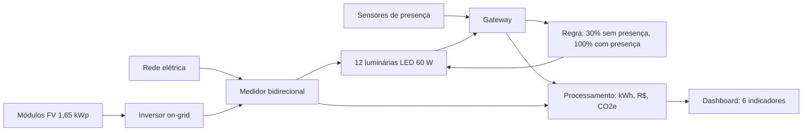

# Praça Acesa – Contribuição de SERS ao Neighborhood Action Dashboard (CitizenTech)

**Integrantes:** _(nome completo e RM de cada integrante)_
**Disciplina:** Soluções em Energias Renováveis e Sustentáveis – Global Solution 2026.2
**Contribuição de SERS:** pasta `sers/` (este README e `dashboard_sers.html`)

## 1. Diagnóstico

- **Espaço:** praça comunitária de bairro (referência: São Paulo/SP), com 12 postes de iluminação.
- **Problema:** luminárias de vapor de sódio (175 W com reator) acesas 12 h por noite, sem nenhum controle. Consomem muito, mesmo em horários sem frequentadores.
- **Público:** moradores, idosos, crianças e quem passa pela praça à noite (segurança e uso do espaço).
- **Condições de funcionamento:** noite (18h–6h), operação diária, ponto de conexão à rede existente.
- **Benefícios esperados:** menor custo para a prefeitura ou associação, praça mais bem iluminada quando há gente, menos emissões e dados abertos de consumo para a comunidade.

## 2. Consumo (E = P × t / 1000)

Premissas: 12 postes, 12 h/dia, 365 dias.

| Item | Cálculo | Resultado |
|---|---|---|
| Diário (base) | 12 × 175 W × 12 h / 1000 | 25,2 kWh/dia |
| Anual (base) | 25,2 × 365 | **9.198 kWh/ano** (766,5 kWh/mês) |

## 3. Alternativas (mesma necessidade: iluminar 12 postes, 12 h/noite, 1 ano)

Premissas das alternativas: LED 60 W; dimerização a 30% da potência em 60% das horas noturnas (sem presença), logo horas equivalentes = 12×0,4 + 12×0,6×0,3 = 6,96 h; sensores e gateway 2 W × 12 pontos × 24 h; FV com 3 módulos de 550 Wp (1,65 kWp), irradiação média 4,5 kWh/m²/dia e desempenho global 0,80; tarifa B4a de R$ 0,434/kWh (R$ 259,83 + R$ 174,33 por MWh, sem tributos); fator de emissão 0,0442 kg CO₂e/kWh (média simples jan–set/2026, inventário MCTI).

| Cenário | kWh/ano | Economia | R$/ano (rede) | Investimento | Retorno simples |
|---|---|---|---|---|---|
| Base (vapor de sódio) | 9.198 | – | 3.993 | – | – |
| A: LED | 3.154 | 65,7% | 1.369 | R$ 7.200 | ≈ 2,7 anos |
| B: LED + sensores/dimerização | 2.039 | 77,8% | 885 | R$ 9.960 | ≈ 3,2 anos |
| **C: B + FV on-grid (renovável)** | ≈ 0 líquido | ≈ 100% | ≈ 0 (limite superior) | R$ 18.210 | ≈ 4,6 anos |

Cálculos-chave:
- A: 12 × 60 × 12 / 1000 × 365 = 3.153,6 kWh/ano.
- B: 12 × 60 × 6,96 / 1000 × 365 = 1.829 kWh + sensores 12 × 2 × 24 / 1000 × 365 = 210 kWh, total 2.039 kWh/ano.
- C: 1,65 kWp × 4,5 × 365 × 0,80 = **2.168 kWh/ano** (≈ 106% do consumo de B).
- Investimentos (estimativas a validar com orçamentos): LED R$ 450 + instalação R$ 150 por poste; sensor R$ 180 por poste + gateway R$ 600; FV R$ 5.000/kWp instalado.
- Retorno incremental do FV sobre B: 8.250 / 885 ≈ **9,3 anos**, com vida útil de módulos ≈ 25 anos.

| Critério | A: LED | B: LED + sensores | C: B + FV |
|---|---|---|---|
| Viabilidade técnica | Alta | Alta (precisa de comunicação) | Média: área para módulos e regra de conexão |
| Impacto ambiental | Menos consumo, descarte de mercúrio evitado | Idem | Maior; geração limpa, mas energia embutida nos módulos |
| Benefício | Retorno rápido | Economia e luz sob demanda | Neutralidade do consumo da praça |
| Limitação | Sem controle por presença | Sensores exigem manutenção | Maior investimento; depende de compensação de créditos |

**Leitura honesta:** como a rede brasileira já é majoritariamente renovável, as emissões evitadas são pequenas (cerca de 317 kg CO₂e/ano em B, calculado como (9.198 − 2.039) × 0,0442). O principal ganho de A e B é econômico. O FV acrescenta autonomia e valor educativo, com retorno mais longo.

**Observação de viabilidade:** no Brasil a iluminação pública costuma ser responsabilidade municipal. A proposta supõe execução pela prefeitura ou por associação com autorização, e geração on-grid com créditos de compensação (Lei 14.300/2022). Confirmar regras locais.

## 4. Diagrama conceitual

## 5. Indicadores (cenário C, projeções)

| Indicador | Unidade | Cálculo |
|---|---|---|
| Consumo de energia | kWh/mês | Σ P × t por cenário |
| Economia energética | % da rede | 1 − consumo líquido / consumo base |
| Redução de custos | R$/mês | (kWh base − kWh líquido) × tarifa / 12 |
| Participação renovável | % | geração FV / consumo (máx. 100%) |
| Emissões evitadas | kg CO₂e/ano | kWh economizados × 0,0442 |
| Tempo de funcionamento eficiente | h/dia equivalentes | 12×0,4 + 12×0,6×0,3 |

## 6. Dashboard

`dashboard_sers.html` permite trocar de cenário e alterar número de postes, horas, tarifa e kWp. Todos os indicadores e gráficos usam os cálculos acima. Para integrar ao dashboard do projeto, reutilize a função `calc()` do arquivo.

## 7. Referências (ABNT)

ANEEL. **Resolução Normativa nº 1.000, de 7 de dezembro de 2021.** Estabelece as Regras de Prestação do Serviço Público de Distribuição de Energia Elétrica. Brasília, DF: ANEEL, 2021.

ANEEL. **Resolução Homologatória nº 3.596/2026:** tarifas de aplicação da ENEL – subgrupo B4 (iluminação pública). São Paulo, DF: SP, 2026. Disponível em: (https://www.enel.com.br/pt-saopaulo/Para_Voce/tarifa-energia-eletrica.html). Acesso em: 18/11/2026.

BRASIL. **Lei nº 14.300, de 6 de janeiro de 2022.** Institui o marco legal da microgeração e minigeração distribuída, o Sistema de Compensação de Energia Elétrica (SCEE) e o Programa de Energia Renovável Social (PERS). Diário Oficial da União, Brasília, DF, 7 jan. 2022. Disponível em: https://www.planalto.gov.br/ccivil_03/_ato2019-2022/2022/lei/L14300.htm. Acesso em: 18/11/2026.

BRASIL. Ministério da Ciência, Tecnologia e Inovação. **Fatores de emissão de CO₂ pela geração de energia elétrica no Sistema Interligado Nacional do Brasil:** fator médio mensal e anual (tCO₂/MWh), 2006 a set. 2026. Brasília, DF: MCTI, 2026. Planilha eletrônica (Inventario_2026_janset.xlsx). Dados do SIRENE. Disponível em: [URL do MCTI/SIRENE]. Acesso em: 18/11/2026.

CRESESB. **SunData v3.0:** potencial solar – irradiação no plano inclinado. Rio de Janeiro: CEPEL, [s.d.]. Disponível em: https://cresesb.cepel.gov.br/index.php?section=sundata. Acesso em: 18/11/2026.

PEREIRA, E. B. *et al.* **Atlas brasileiro de energia solar.** 2. ed. São José dos Campos: INPE, 2017. Disponível em: http://labren.ccst.inpe.br/atlas_2017.html. Acesso em: 18/11/2026.

PREFEITURA MUNICIPAL DE ERECHIM. Registro de preços: luminárias viárias LED, itens 92 a 113. Erechim, RS, [s.d.]. Disponível em: https://pmerechim.rs.gov.br/uploads/paginas/0452a2442aab2edc57129d087e4b01fd.pdf. Acesso em: 17 nov. 2026.

ORSE. Composição ORSE-13065: luminária pública decorativa a LED Linha Planetária 60 W. Disponível em: https://orcamentor.com/orse/composicoes/ORSE-13065/. Acesso em: 17 nov. 2026.

ORSE. Composição ORSE-13202: luminária LED LPL ÁTON 60 com telegestão. Disponível em: https://orcamentor.com/orse/composicoes/ORSE-13202/. Acesso em: 17 nov. 2026.

MAGAZINE LUIZA. Busca "kit solar microinversor" e marca Growatt. Disponível em: https://m.magazineluiza.com.br/busca/kit+solar+microinversor e https://www.magazineluiza.com.br/marcas/growatt. Acesso em: 17 nov. 2026.

KOMECO. Kit geração de energia solar 1,10 kWp. Disponível em: https://loja.komeco.com.br/kit-geracao-de-energia-solar-110-kwp-ceramico/p. Acesso em: 17 nov. 2026.

### Origem de cada dado

| Dado | Valor | Fonte |
|---|---|---|
| Tarifa B4a | R$ 259,83 + R$ 174,33 por MWh | ANEEL, resolução homologatória da distribuidora |
| Fator de emissão | 0,0442 tCO₂/MWh (média jan–set/2026) | MCTI |
| Irradiação média | ≈ 4,5 kWh/m²/dia (mensal no dashboard) | Atlas Solar (INPE) / SunData |
| Potência das luminárias | 175 W (base), 60 W (LED) | Premissa; conferir em fichas técnicas |
| Custos unitários | R$ 450 + 150, R$ 180, R$ 600, R$ 5.000/kWp | Premissa; substituir por orçamentos |
| Regra de dimerização | 60% das horas sem presença, a 30% | Premissa; validar com contagem de uso |

## 8. Limitações

- Valores de potência, custos, tarifa, irradiação e fator de emissão são estimativas e devem ser validados.
- A dimerização supõe 60% das horas sem presença, o que depende do uso real da praça.
- A geração FV é diurna e o consumo é noturno; o balanço depende de créditos de compensação. Não há baterias.
- Retorno simples, sem inflação, reajuste de tarifa, manutenção ou desconto financeiro.
- A tarifa usada soma as duas parcelas informadas (259,83 + 174,33 R$/MWh, interpretadas como TUSD + TE) e não inclui tributos nem contribuição de iluminação pública; o fator de emissão é média simples dos meses disponíveis, sem ponderar por geração.
- Todas as economias são projeções condicionadas às premissas, não resultados garantidos.
